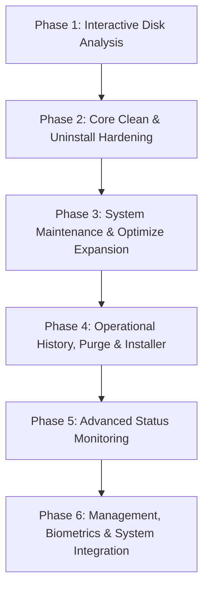

# Plan: Upstream Mole Parity for mu (Ubuntu)

## Outcome
- result: `mu` achieves comprehensive feature parity with upstream Mole (`tw93/mole` @ `7867c80` / `V1.59.1`), adapted idiomatically and safely to the Ubuntu/Debian Linux desktop and server ecosystem. Every missing or partial upstream feature is either implemented across 6 shippable, risk-ranked phases or documented as N/A macOS-only with technical justification. All operations preserve `mu`'s inviolable safety invariants (preview-before-destroy, trash-not-delete via `trash::SafeDelete`, fail-closed whitelist checks, and operation logging).
- success_signals:
  - `make test` passes with zero regressions across all unit and integration suites (312+ baseline tests preserved).
  - Interactive Disk Analysis (Phase 1): `mu analyze` provides an interactive ncdu-like Ratatui disk usage explorer with `--json`, `--dry-run` immutability proof, and in-app safe trash deletion.
  - Clean & Uninstall enhancements (Phase 2): Snap/Flatpak browser caches detected, `system-trash` clean target reclaims space safely with size and item count preview via `gio trash --empty` (failing closed without `--yes` in headless mode), preview ledger exported to `$XDG_CONFIG_HOME/mu/clean-list.txt`, `mu uninstall <pkg>` executes non-interactively from CLI, `mu uninstall --list` outputs installed packages, and `--permanent` is explicitly rejected with a helpful safety error.
  - Optimize & Clean extensions (Phase 3): `mu optimize` expands from 3 to 9 safe maintenance units (DNS cache flush, broken package config repair, failed systemd unit reset, unused Flatpak runtime cleanup, SQLite vacuum, stale state cleanup, broken autostart audit, broken services audit, and home permissions audit) with `--skip` support and exact shell command display in `--dry-run`; optional clean targets for developer CLI caches (`--include=dev-cache`), Podman (`--include=podman`), and orphaned user services (`--include=orphaned-services`). The dangerous route/neighbor table flush is dropped and marked N/A as it severs live SSH connections.
  - History, Purge & Installer (Phase 4): `mu history` inspects `$XDG_DATA_HOME/mu/operations.log` in table and `--json` format; `mu purge` safely cleans heavy project build artifacts (`node_modules`, `target`, `dist`, `.venv`) with `--paths`, `--dry-run`, and `--yes`; `mu installer` finds and cleans large package installers in `~/Downloads`.
  - Advanced Status Monitoring (Phase 5): `mu status` supports continuous NDJSON streaming via `--watch [--interval 1s]` and surfaces per-core CPU, disk I/O, battery, and top process stats.
  - Management & Biometrics (Phase 6): `mu sudo` provides PAM fingerprint configuration (`enable`, `disable`, `status`) mirroring `mo touchid`; `mu update` checks GitHub releases and self-updates verified binaries; `mu remove` safely uninstalls `mu`; `mu completion --install` auto-installs shell scripts.
  - Main Menu Alignment (refine 2026-10-21): root TUI menu lists Audit, Clean, Uninstall, Optimize, Analyze, Status, Quit (Analyze after Optimize, as upstream `mole:186-190`); Purge and Installer are removed from the menu and remain reachable via `mu purge` / `mu installer`.
  - Analyze UX Parity (refine 2026-10-21, upstream `cmd/analyze` @ `V1.61.0`): no-arg `mu analyze` opens an overview of locations plus hidden-space insights (e.g. `~/Downloads` files older than 90 days); `Space` multi-select and `⌫` batch delete via `trash::SafeDelete` behind YES/NO confirm; `/` name filter; cleanable-dir badges (`node_modules`, `target`, `CACHEDIR.TAG`) excluding paths already covered by `mu clean`; `R` rescan, `O` open via `xdg-open`, `P` preview, `F` reveal file; versioned on-disk scan cache under `$XDG_CACHE_HOME/mu/` that rejects stale schema.

## Authority and Requirements
- authority:
  - `AGENTS.md` / `CLAUDE.md`: Inviolable safety invariants — `trash::SafeDelete` via FreeDesktop/gio trash only (never `rm`), protected prefixes in `src/paths.rs` plus user `protected_paths`, fail-closed TOML configuration, APT-policy-only autoremove, opt-in high-impact clean categories, dry-run on every destructive action, operation logging to `$XDG_DATA_HOME/mu/operations.log`.
  - `mu-prd.md`: Product requirements for Ubuntu system cleaner and optimizer, command specification (`mu`, `clean`, `uninstall`, `optimize`, `status`, `analyze`, `purge`, `installer`, `sudo`/`touchid`, `update`, `remove`), P0/P1/P2 priorities, terminal UI conventions.
  - `docs/decisions/0006-rust-rewrite-accepted-parity-divergences.md`: Rust rewrite baseline contracts, golden fixtures in `tests/golden/`, byte-exact help/error parity requirements.
  - Upstream Mole: `https://github.com/tw93/mole` @ release `V1.61.0` (pin moved 2026-10-21 from `7867c80` / `V1.59.1`, the baseline of the gap matrix below) (`lib/core/commands.sh`, `lib/core/help.sh`, `bin/*.sh`, `lib/*/*.sh`, `cmd/*`).
  - Inventory Baseline: `~/quaqua/runs/detu-muinv2.md` comprehensive feature inventory.
- requirements:
  - R1 [safety]: All user-file deletions must route strictly through `trash::SafeDelete` — moves to trash, never `rm`. Upstream features bypassing trash (e.g. `--permanent`) must be explicitly rejected.
  - R2 [preview]: Every destructive command (`clean`, `uninstall`, `optimize`, `purge`, `installer`, `remove`) must implement a `--dry-run` flag that previews actions, exact commands, and disk space without side effects, proven by sentinel file immutability tests.
  - R3 [parity]: Implement missing and partial Mole CLI commands and sub-flags where valid on Linux: `mu uninstall <pkgs...>`, `mu uninstall --list`, `mu history`, `mu purge`, `mu installer`, `mu analyze`, `mu sudo`, `mu update`, `mu remove`.
  - R4 [ubuntu-native]: Map upstream macOS mechanisms to native Ubuntu/Debian equivalents: APT/Snap/Flatpak packages, systemd user and system services, XDG base directories, PAM fingerprint authentication (`pam_fprintd.so`), `resolvectl` DNS maintenance.
  - R5 [contract]: Retain byte-exact CLI contract compatibility for existing commands where golden tests assert output (`tests/golden/`), updating golden files only alongside intentional new CLI subcommands.
  - R6 [headless]: Non-interactive / headless scripting paths must be supported when flags or arguments are explicitly passed (`mu uninstall <pkg>`, `mu clean --yes`, `mu optimize --yes`, `mu status --json`), while preserving existing TTY-check error behavior when interactive TUI commands are called headless without args.
  - R7 [menu]: `MENU_ITEMS` order is exactly Audit, Clean, Uninstall, Optimize, Analyze, Status, Quit, asserted by a `menu_items_order` test; `mu purge --help` and `mu installer --help` output stays byte-identical to `tests/golden/`.
  - R8 [analyze-ux]: Delivered in order 7a menu (R7) → 7b `Space` multi-select, `⌫`/`Delete` batch delete, `/` filter (`⌫` edits text in filter mode) → 7c overview, insights, badges, `R`/`O`/`P`/`F` → 7d scan cache. Each Analyze UX feature in the success signals has a `TestBackend` or unit test; batch delete logs every trashed path to the oplog, refuses whitelisted paths, and changes nothing on NO or with `--dry-run`; a cache whose schema version mismatches is ignored and rescanned. Batch delete drops descendants of selected ancestors, re-lstats each path before trashing, excludes whitelisted paths at selection, continues and reports on partial failure, and invalidates the cache. Cache is keyed by schema version + canonical root, written atomically (tmp + rename), treats a corrupt file as a miss, and `R` bypasses it; no new analyze flags are added, so `help-analyze` golden stays unchanged (R5). `O`/`F` run through the `Runner` trait (FakeRunner in tests) and show a message when no DISPLAY is set. Cleanable badges derive the `mu clean` exclusion from the clean target roots. No-arg overview is TTY-only; `mu analyze --json` and the non-TTY error stay unchanged (R6).
  - R9 [hardening]: Lands before 7b. Mapped from upstream V1.61.0 safety fixes: an unreadable (EACCES), not only malformed, user config blocks `clean`, `optimize`, `purge`, `installer` and `uninstall`; unknown whitelist paths are rejected before cleanup; `mu uninstall` and `mu remove` exit nonzero when no TTY can confirm and `--yes` is absent. Each case has a failure-path test.

## Non-goals
- NG1: Implementing macOS-specific features on Linux (e.g. Rosetta 2 caches, iOS simulator firmware, APFS Time Machine snapshot thinning, Gatekeeper quarantine database, macOS `.DS_Store` suppression, Spotlight `mdutil` index rebuilds, Raycast/Alfred launcher scripts).
- NG2: Transliterating macOS launchd / launchctl workflows into systemd without respecting Linux multi-user session architecture.
- NG3: Bypassing trash for faster deletion or adding unsafe raw `rm -rf` flags.
- NG4: Driving real GUI desktop sessions or taking screen captures (must obey `No GUI driving` constraint).
- NG5: Running unsafe network stack flushes (`ip route/neigh flush`) that drop live SSH or network connections.
- NG6: Analyze APFS clone accounting and Time Machine local snapshot detection (macOS-only, `clone_darwin.go`, `snapshots.go`).
- NG7: Removing the `purge` / `installer` CLI commands — only their menu entries are dropped.

## Safety Invariants & Conflict Decisions

### Conflict 1: Upstream `--permanent` Flag on Uninstall
- **Upstream Behavior:** `mo uninstall --permanent [APP]` (`bin/uninstall.sh:1989-1991`) calls `rm -rf` directly on app files and leftovers, bypassing the macOS Trash (`lib/uninstall/batch.sh:657`).
- **mu Safety Invariant:** `CLAUDE.md` and `AGENTS.md` explicitly mandate:
  > "Safety invariants (never bypass): All user-file deletion goes through `trash::SafeDelete` — moves to trash, never `rm`."
- **Conflict Analysis:** In `mu`, the zero-data-loss guarantee is an inviolable architectural premise. App remnant scanning relies on pattern and directory name heuristics (`~/.config/<name>`, `~/.local/share/<name>`). If remnants resolution captures a path that contains user data or a shared directory, `trash::SafeDelete` ensures the user can restore it from `$XDG_DATA_HOME/Trash`. Bypassing trash with immediate `rm -rf` introduces irreversible data loss risk.
- **Decision:** **REJECT `--permanent` in `mu`.**
  When passed to `mu uninstall`, `mu` will refuse to execute, exiting with exit code 1 and printing:
  `error: --permanent is rejected: mu enforces SafeDelete via trash only to guarantee recoverability. To free space after uninstalling, review and empty trash via 'gio trash --empty' or 'mu clean --include=system-trash'.`
  This explicitly upholds the safety contract while educating the user on safe space reclamation.

### Conflict 2: Automatic System-Wide Cache Cleans Without Sudo Warning
- **Upstream Behavior:** Mole runs certain cleanup operations that touch root-owned caches (`/Library/Caches`) prompting for sudo ad-hoc.
- **mu Safety Invariant:** `mu-prd.md` §5.2: "Path validation: never touch `/`, `/boot`, `/etc` without explicit flag"; `src/clean/targets.rs` separates `requires_sudo: false` (user cache, browser cache) from `requires_sudo: true` (APT archives, journalctl).
- **Decision:** All root-level maintenance and clean targets must remain explicitly labeled with `requires_sudo: true`. `mu` requests elevated permissions only for those specific targets and informs the user in the plan preview before executing.

### Conflict 3: Empty System Trash Safety & Preview
- **Upstream Behavior:** Mole empties Trash during standard clean (`lib/clean/user.sh:40-149`, `bin/clean.sh:1741`).
- **mu Safety Invariant:** Moving deleted items to Trash is `mu`'s primary safety net. Emptying Trash is a permanent, non-recoverable deletion. If `mu clean` emptied Trash by default, the safety net would be neutralized for items deleted immediately prior.
- **Decision:** Emptying Trash must be strictly an **Opt-In** clean target (`id: "system-trash"`, `--include=system-trash`).
  1. **Default Off:** It is deselected by default in interactive TUI mode and excluded from default CLI clean.
  2. **Size & Item Count Preview:** In `--dry-run` and interactive preview, it calculates and displays both total bytes and item count (e.g. `System Trash (14 items) ... 82.4 MB`).
  3. **Strict Confirmation & Headless Fail-Closed:** In interactive TUI mode, it requires an explicit YES confirmation dialog. In non-interactive CLI mode, it requires the `--yes` flag; without `--yes`, it aborts and fails closed without emptying anything.
  4. **Strict `gio trash --empty` Execution:** Execution must strictly run via `gio trash --empty` (or standard FreeDesktop trash specification traversal). Direct directory purging (`rm -rf ~/.local/share/Trash/*`) is forbidden.

---

## Comprehensive Gap & Parity Matrix

The following table catalogs every user-facing feature from upstream Mole (`tw93/mole` @ `7867c80` / `V1.59.1`) that `mu` lacks or covers partially, with exact upstream source refs, `mu` codebase citations, and Ubuntu/Linux technical mappings.

| Feature | Upstream Ref | mu Status & Citations | Ubuntu Mapping & Strategy |
| :--- | :--- | :--- | :--- |
| **CLI: Update Notice Banner** | `mole:143-157`, `mole:240`, `lib/manage/update.sh` | **missing**: no update check logic in `src/` | Query GitHub Releases API in background thread; cache latest version in `$XDG_CACHE_HOME/mu/last_version_check.json`; render subtle badge in `src/tui/menu.rs` if `latest > current`. |
| **CLI: Biometric Status Hint** | `mole:134-141`, `mole:288` | **missing**: no biometric detection in `src/` | Probe PAM configuration (`/etc/pam.d/sudo` contains `pam_fprintd.so` or `fprintd-verify`); display biometric status hint in root TUI menu. |
| **Clean: Exported Preview Ledger** | `bin/clean.sh:38`, `bin/clean.sh:75` | **missing**: output only printed to screen | During `clean --dry-run` or before execution, serialize scanned target items and paths to `$XDG_CONFIG_HOME/mu/clean-list.txt` for auditability. |
| **Clean: Whitelist Interactive TUI** | `bin/clean.sh:34`, `lib/manage/whitelist.sh:32` | **missing**: `src/config.rs:75` loads TOML; no interactive editor | Implement interactive checklist in Ratatui to view and toggle `protected_paths` and `cache_skip.dirs` in `~/.config/mu/config.toml`. |
| **Clean: External Volume Metadata** | `bin/clean.sh:1717-1721`, `lib/clean/system.sh` | **missing**: `src/clean/targets.rs` only targets root & home | Flag `mu clean --external <MOUNT_PATH>`: cleans `.Trash-*`, `.directory`, temporary mount metadata under `/media/$USER/*` or `/mnt/*`. |
| **Clean: Empty System Trash** | `lib/clean/user.sh:40-149`, `bin/clean.sh:1741` | **partial**: `src/trash.rs:24-80` deletes *to* Trash; `src/clean/targets.rs` has no target to empty Trash | Add opt-in clean target `system-trash`: previews size and item count; requires `--yes` or explicit confirmation; executes only via `gio trash --empty`. |
| **Clean: Browser Caches (Extended)** | `lib/clean/caches.sh`, `bin/clean.sh:1752` | **partial**: `src/clean/scan_browser.rs:13-50` only handles native Chrome, Firefox, VSCode under `~/.config` and `~/.mozilla` | Add Snap browser paths (`~/snap/firefox/common/.cache/`, `~/snap/chromium/common/.cache/`), Flatpak paths (`~/.var/app/*/cache/`), and Chromium forks (Brave, Edge, Opera, Vivaldi, Zen). |
| **Clean: Protected Web Domains** | `lib/clean/caches.sh:44-63`, `bin/clean.sh:1752` | **missing**: `src/clean/scan_browser.rs:85-100` deletes whole cache paths | Whitelist ServiceWorker and IndexedDB folders for key productivity domains (Google Docs, GitHub, Figma, Linear) to prevent losing offline PWA state. |
| **Clean: Virtualization Tools** | `lib/clean/dev.sh`, `bin/clean.sh:1784` | **missing**: `src/clean/scan_docker.rs` only handles Docker | Add opt-in clean target `podman` (`podman system prune -f`) and `multipass` (`multipass purge`) when their CLI sockets/binaries exist. |
| **Clean: Developer CLI Caches** | `lib/clean/dev.sh`, `bin/clean.sh:1774` | **missing**: denylisted in `src/default-whitelist.toml:28-37` | Add opt-in clean target `dev-cache` (`--include=dev-cache`) for `~/.cache/pip`, `~/.npm/_cacache`, `~/.cargo/registry/cache`, `~/.cache/go-build`. |
| **Clean: IDE Caches** | `lib/clean/dev.sh`, `bin/clean.sh:1774` | **missing**: whitelisted in `src/default-whitelist.toml:44` | Add opt-in clean target `ide-cache` for stale caches in `~/.cache/JetBrains/*/caches` and `~/.cache/Google/AndroidStudio*/caches`. |
| **Clean: Cloud & Office Caches** | `lib/clean/caches.sh`, `bin/clean.sh:1760` | **missing**: no cloud/office targets in `src/clean/` | Clean caches for `~/.dropbox/cache`, `~/.config/Slack/Cache`, `~/.config/Slack/Service Worker/CacheStorage`, `~/.config/Microsoft/Teams/Cache`. |
| **Clean: Orphaned App Data** | `lib/clean/apps.sh:650`, `bin/clean.sh:1794` | **missing**: `src/uninstall/remnants.rs` only runs during uninstallation | Scan `$XDG_DATA_HOME` and `$XDG_CONFIG_HOME` for directory names that do not map to any currently installed APT, Snap, or Flatpak package; present as opt-in clean target. |
| **Clean: Orphaned System Services** | `lib/clean/apps.sh:933`, `bin/clean.sh:1795` | **missing**: no service orphan cleaner in `src/clean/` | Scan `~/.config/systemd/user/` and `/etc/systemd/system/` for broken symlinks or service units pointing to non-existent executable binaries. |
| **Clean: Large Files Hint** | `lib/clean/hints.sh`, `bin/clean.sh:1817` | **missing**: no hints in `src/clean/` | Scan `$HOME/Downloads` for files >500MB and print an informative advisory at the end of `mu clean`. |
| **Clean: Project Artifacts Hint** | `lib/clean/hints.sh`, `bin/clean.sh:1822` | **missing**: no project hint in `src/clean/` | Probe default code directories (`~/Projects`, `~/Code`) and suggest running `mu purge` if build artifacts exceed 2 GB. |
| **Uninstall: Direct CLI Args** | `bin/uninstall.sh:1975-2015`, `lib/uninstall/batch.sh` | **missing**: `src/cli.rs:504-506`, `src/cli.rs:972-974` ignore positional args | Enable `mu uninstall <pkg1> <pkg2>`: resolves packages across APT, Snap, and Flatpak; scans remnants; prints removal plan; prompts or respects `--yes`/`--dry-run`. |
| **Uninstall: List Packages Flag** | `bin/uninstall.sh:1992-1994` | **missing**: no `--list` in `src/cli.rs:170-178` | Add `mu uninstall --list`: prints all discovered installed packages with source prefix (`apt:<name>`, `snap:<name>`, `flatpak:<name>`) and size to stdout. |
| **Uninstall: Trash Bypass Flag** | `bin/uninstall.sh:1989-1991`, `lib/uninstall/batch.sh:657` (`--permanent`) | **missing / conflicts**: `src/uninstall/remove.rs` uses `trash::SafeDelete` | **Explicit Decision: REJECT.** Exit with code 1 and explanatory safety error (R1). |
| **Uninstall: Headless / Non-TTY** | `lib/uninstall/batch.sh` | **missing**: `src/uninstall/mod.rs:199-205` exits 1 on non-TTY | Allow headless execution when explicit package args or `--list` are passed; preserve exit 1 error only when bare `mu uninstall` is called without TTY. |
| **Uninstall: Flatpak Discovery** | `bin/uninstall.sh:843-900` | **partial**: `src/uninstall/discover.rs:32, 74` only does APT and Snap | Add Flatpak discovery via `flatpak list --app --columns=application,version,size,origin`. |
| **Uninstall: Systemd Remnants** | `lib/core/app_protection.sh:1111-1260` | **partial**: `src/uninstall/remnants.rs:44-77` misses systemd & .desktop | Scan for `~/.config/systemd/user/<pkg>.service`, `~/.local/share/applications/<pkg>.desktop`, and `~/.config/autostart/<pkg>.desktop`. |
| **Uninstall: Service Termination** | `lib/uninstall/batch.sh:90-130` (`launchctl bootout`) | **missing**: `src/uninstall/remove.rs` does not stop user units | Before removing package and remnants, stop and disable active systemd user units via `systemctl --user stop <unit>` and `systemctl --user disable <unit>`. |
| **Uninstall: Sensitive Data Review** | `lib/uninstall/review.sh:1-50` | **missing**: `src/uninstall/remove.rs` deletes all remnants together | In interactive TUI, provide a sub-item selection screen allowing user to uncheck user data/config directories while purging package binaries. |
| **Uninstall: Steam Game Detection** | `lib/uninstall/steam.sh` | **missing**: no Steam handling in `src/uninstall/` | Detect Steam app manifests under `~/.local/share/Steam/steamapps/appmanifest_*.acf` and provide uninstallation delegation via `steam steam://uninstall/<id>`. |
| **Optimize: Whitelist TUI Editor** | `bin/optimize.sh`, `lib/manage/whitelist.sh:32` | **missing**: `src/config.rs:49` reads `optimize_skip` from TOML | Provide interactive TUI screen to toggle `optimize_skip` steps in `~/.config/mu/config.toml`. |
| **Optimize: Flush DNS Cache** | `lib/optimize/catalog.sh:29, 37` | **missing**: not in `src/optimize.rs:92-121` | Implement step `dns`: execute `sudo resolvectl flush-caches` (or fallback `sudo systemd-resolve --flush-caches`); `flush-caches` is polkit-gated, so the system step runs with sudo (Conflict 2). |
| **Optimize: Network Stack Refresh** | `lib/optimize/catalog.sh:45` | **N/A on Linux**: unsafe on Ubuntu | **DROPPED:** Route cache is obsolete on Linux >= 3.6; neighbor table flush (`ip neigh flush all`) drops active SSH/network sessions. Moved to N/A section. |
| **Optimize: Package Repair** | `lib/optimize/catalog.sh:35` | **missing**: not in `src/optimize.rs` | Implement step `packages`: execute `sudo dpkg --configure -a` and `sudo apt-get install -f -y`. |
| **Optimize: SQLite Database VACUUM** | `lib/optimize/catalog.sh:39` | **missing**: not in `src/optimize.rs` | Implement step `sqlite`: scan Firefox/Chrome/Thunderbird profiles and run `sqlite3 <db> "VACUUM;"` when browser processes are not running. |
| **Optimize: Systemd Failed Units** | Linux equivalent of launchd repair | **missing**: not in `src/optimize.rs` | Implement step `systemd`: execute `sudo systemctl reset-failed` (system scope is polkit-gated) and `systemctl --user reset-failed` (Conflict 2). |
| **Optimize: Flatpak Unused Runtimes** | Linux package orphan cleanup | **missing**: not in `src/optimize.rs` | Implement step `flatpak`: execute `flatpak uninstall --unused -y` if flatpak binary is present. |
| **Optimize: Stale App Saved State** | `lib/optimize/catalog.sh:34` | **missing**: not in `src/optimize.rs` | Implement step `state`: clean files older than 30 days in `~/.local/state/` matching known transient state patterns. |
| **Optimize: User Perms Repair** | `lib/optimize/catalog.sh:47` | **missing**: not in `src/optimize.rs` | Implement step `permissions`: audit files in `$HOME` owned by root or with broken permissions. |
| **Optimize: Filesystem Integrity** | `lib/optimize/catalog.sh:57` | **missing**: not in `src/optimize.rs` | Implement step `disk-health`: query `smartctl` or inspect systemd filesystem check logs in journal. |
| **Optimize: Broken Autostart Audit** | `lib/optimize/catalog.sh:59` | **missing**: not in `src/optimize.rs` | Implement step `autostart`: audit `~/.config/autostart/*.desktop` for missing `Exec` binaries. |
| **Optimize: Broken Services Audit** | `lib/optimize/catalog.sh:63` | **missing**: not in `src/optimize.rs` | Implement step `services`: audit broken symlinks in `/etc/systemd/system/` and `~/.config/systemd/user/`. |
| **Analyze: Full Command Subsystem** | `bin/analyze.sh`, `cmd/analyze/main.go` | **missing**: PRD P1 scope; zero code in `src/` | Implement `mu analyze [PATH]` with Ratatui directory tree navigator, `--json` mode, size sorting, largest files summary, and in-app `trash::SafeDelete`. |
| **Status: Streaming Watch Mode** | `bin/status.sh`, `cmd/status/main.go:33-35` | **missing**: only one-shot `--json` in `src/cli.rs:150-159` | Add `mu status --watch [--interval <dur>]` emitting continuous NDJSON lines to stdout. |
| **Status: Extended System Metrics** | `cmd/status/metrics_*.go` | **partial**: `src/status/proc.rs` only aggregates CPU/Mem/Disk/Net | Add per-core CPU usage, `/proc/diskstats` I/O throughput, hardware model (`/proc/cpuinfo`, DMI), battery status (`/sys/class/power_supply/`), and top processes. |
| **History: Full Command Subsystem** | `bin/history.sh`, `lib/core/history.sh` | **missing**: logging exists in `src/oplog.rs:43`; no CLI command | Implement `mu history [--json] [--limit N]`: reads and parses `$XDG_DATA_HOME/mu/operations.log`, rendering a clean table or structured JSON array. |
| **Purge: Full Command Subsystem** | `bin/purge.sh`, `lib/clean/project.sh` | **missing**: PRD P1 scope; zero code in `src/` | Implement `mu purge`: scans configurable roots (`--paths`) for `node_modules`, `target`, `dist`, `build`, `.venv`; supports `--dry-run`, `--yes`, `--include-empty`. |
| **Installer: Full Command Subsystem** | `bin/installer.sh` | **missing**: PRD P2 scope; zero code in `src/` | Implement `mu installer`: scans `$HOME/Downloads` for `.deb`, `.AppImage`, `.iso`, `.tar.gz`; supports `--dry-run` and safe trash deletion. |
| **Touch ID / Sudo Biometrics** | `bin/touchid.sh:27-31` | **missing**: PRD §5.3 scope (`mu sudo`) | Implement `mu sudo [enable|disable|status]` using `pam-auth-update` / `pam_fprintd.so` for fingerprint sudo auth on supported hardware. |
| **Completion: Auto-Installation** | `bin/completion.sh:90-120` | **partial**: `src/cli.rs:1062` generates scripts to stdout | Add `mu completion --install [SHELL]`: automatically writes to `/etc/bash_completion.d/mu`, `~/.zsh/completion/_mu`, or `~/.config/fish/completions/mu.fish`. |
| **Update: Self-Update Subsystem** | `lib/manage/update.sh`, `mole:347-360` | **missing**: PRD §5.3 scope; zero code in `src/` | Implement `mu update [--dry-run|--force|--nightly]`: checks GitHub Releases, verifies release checksums via SHA-256, atomically replaces binary. |
| **Remove: Clean Self-Removal** | `lib/manage/remove.sh:45`, `mole:363-373` | **missing**: PRD §5.3 scope; zero code in `src/` | Implement `mu remove [--dry-run]`: removes binary, desktop launcher, completions; moves `$XDG_CONFIG_HOME/mu` to trash; deletes logs/caches. |
| **Launchers: Desktop Integration** | `scripts/setup-quick-launchers.sh` | **missing**: no desktop entry generator | Add script or flag to install `~/.local/share/applications/mu.desktop` for GNOME/KDE launcher integration. |

---

## Features N/A on Ubuntu (macOS-Only)

The following upstream Mole features are strictly tied to proprietary macOS subsystems, Darwin kernel APIs, Apple Silicon hardware, or are demonstrably dangerous on Linux systems. They have no meaningful equivalent on Ubuntu/Linux and are intentionally excluded from `mu`:

| Upstream Feature | Upstream Ref | Technical Reason N/A on Ubuntu / Linux |
| :--- | :--- | :--- |
| **Rosetta 2 & dyld Shared Caches** | `bin/clean.sh:1803`, `lib/clean/system.sh:120` | Apple Silicon architecture translation layer (`/Library/Apple/usr/libexec/oah/`) and Darwin dyld shared cache files do not exist on Linux ELF systems. |
| **Time Machine APFS Snapshots** | `bin/clean.sh:1812`, `lib/clean/system.sh` | Relies on macOS APFS filesystem snapshot thinning utility (`tmutil thinlocalsnapshots`). Linux backup tools (Timeshift, Snapper, Btrfs, ZFS) operate under entirely different user-configured paradigms. |
| **iOS / Xcode Simulator Support & Firmware** | `bin/clean.sh:1808`, `lib/clean/user.sh` | macOS-exclusive Xcode simulator runtimes, DeviceSupport caches, and Apple IPSW firmware restore images. |
| **Homebrew Cask App Uninstaller** | `lib/uninstall/brew.sh` | macOS Homebrew Cask GUI app management (`brew uninstall --cask`) is macOS-specific. Ubuntu native package managers (APT, Snap, Flatpak) are handled in `mu uninstall`. |
| **Raycast & Alfred Quick Launchers** | `scripts/setup-quick-launchers.sh` | Proprietary macOS launcher script protocols (`raycast://`, `alfred://`) do not exist on Linux. Desktop launcher integration on Ubuntu uses standard Freedesktop `.desktop` files in `~/.local/share/applications/` (handled in Phase 6). |
| **Network Stack Refresh (Routing & ARP)** | `lib/optimize/catalog.sh:45` | Obsolete and dangerous on Linux: route cache (`sudo ip route flush cache`) was removed in Linux kernel 3.6, and neighbor table flush (`sudo ip neigh flush all`) severs active network connections and remote SSH sessions. Not a safe maintenance default on Ubuntu. |
| **Prevent .DS_Store on Network/USB** | `lib/optimize/catalog.sh:41` | Toggles macOS Finder proprietary desktop services preference `DSDontWriteNetworkStores` / `DSDontWriteUSBStores`. |
| **Legacy Overrides Audit** | `lib/optimize/catalog.sh:43` | Audits macOS `NSGlobalDomain` App Nap and disk image verification overrides created by legacy macOS tweakers. |
| **Spotlight Index Optimization & Rebuild** | `lib/optimize/catalog.sh:49-53` | Manages Darwin Spotlight metadata search indexing engine via `mdutil -E /` and `mdimport`. |
| **Periodic Maintenance Scripts** | `lib/optimize/catalog.sh:55` | Runs BSD `/etc/periodic/{daily,weekly,monthly}` maintenance scripts, which are absent from modern Linux systemd distributions (handled via systemd timers). |
| **Shared File Lists (Favorites) Repair** | `lib/optimize/catalog.sh:56` | Repairs Apple Foundation framework shared file list bookmark blobs (`sfltool`, `com.apple.LSSharedFileList.*.sfl2`). |
| **Gatekeeper Quarantine Database** | `lib/optimize/catalog.sh:61` | Clears Apple Gatekeeper download history SQLite database (`~/Library/Preferences/com.apple.LaunchServices.QuarantineEventsV2`). |
| **Notification Center Database Bloat** | `lib/optimize/catalog.sh:65` | Clears macOS Notification Center notification history SQLite records. |
| **CoreDuet User Activity Tracking Data** | `lib/optimize/catalog.sh:67` | Clears Apple CoreDuet knowledge base activity records (`/var/db/CoreDuet/knowledge-base.db`). |

---

## Phased Implementation Roadmap

The implementation is broken into 6 risk-ranked, shippable phases. Each phase is independently testable, preserves all safety invariants, and builds systematically on `mu`'s modular Rust architecture.



---

### Phase 1: Interactive Disk Analysis (`mu analyze`)
- **Slug:** `interactive-disk-analyzer`
- **Story ID:** `MU-002-interactive-disk-analyzer`
- **Value:** **High** — Completes PRD §5.1 P1 command `mu analyze` (ncdu-style interactive disk usage explorer).
- **Risk:** **High** — Large new Ratatui TUI component (`analyze`), filesystem walker traversing entire directory trees, and interactive tree navigation.
- **Scope:**
  - **`mu analyze` Subsystem:**
    - Argument: `mu analyze [PATH]` (defaults to overview of root `/` and `$HOME`).
    - Flag: `--json` for machine-readable tree output.
    - Flag: `--dry-run` to preview scan metrics and ensure in-app deletion is disabled.
    - High-performance directory tree scanner with size aggregation and largest file heap.
    - Ratatui interactive explorer: navigate folders with arrow/Vim keys, sort by size/name, drill into subdirectories.
    - In-app deletion: select item, press 'd', confirm with YES/NO dialog, delete via `trash::SafeDelete`.
- **Files Likely Touched:**
  - `src/analyze/` (new module: `walker.rs`, `model.rs`, `json.rs`)
  - `src/tui/analyze.rs` (new Ratatui explorer widget)
  - `src/cli.rs`
  - `tests/cli_integration.rs`
- **Safety Invariants Preserved:**
  - Disk analysis deletion strictly uses `trash::SafeDelete` with default-NO confirmation.
  - Path validation prevents attempting deletion of protected root prefixes (`/`, `/usr`, `/etc`).
  - `--dry-run` guarantees zero deletions.
- **Concrete Acceptance Tests:**
  1. `cargo run --release -- analyze --json /tmp` -> exit 0; emits JSON directory tree structure.
  2. Sentinel immutability test (analyze):
     ```bash
     mkdir -p /tmp/mu-analyze-test && touch /tmp/mu-analyze-test/sentinel.dat
     cargo run --release -- analyze --dry-run /tmp/mu-analyze-test
     test -f /tmp/mu-analyze-test/sentinel.dat
     ```
     -> exit 0; confirms analyze dry-run did not modify or delete `sentinel.dat`.
  3. `cargo run --release -- analyze --help` -> exit 0; renders analyze usage, arguments, and options.
  4. `make test` -> all unit and integration tests pass.

---

### Phase 2: Core Clean & Uninstall Hardening & Parity
- **Slug:** `core-clean-uninstall`
- **Story ID:** `MU-003-clean-uninstall-parity`
- **Value:** **High** — Solves critical gaps in primary P0 commands (`clean` and `uninstall`). Enables CLI scripting, expands browser coverage to modern Ubuntu Snap/Flatpak defaults, adds safe Trash reclamation with item count preview, and adds interactive remnant review.
- **Risk:** **Medium** — Touches destructive deletion paths; must strictly adhere to `trash::SafeDelete` and safety invariants.
- **Scope:**
  - Expand `browser-cache` scanner in `src/clean/scan_browser.rs` to detect Snap Firefox/Chromium, Flatpak browsers, and Brave/Edge/Opera/Zen.
  - Implement PWA domain protection for ServiceWorker/IndexedDB directories.
  - Add `system-trash` opt-in clean target (`--include=system-trash`):
    - Previews BOTH size and item count: e.g. `System Trash (14 items) ... 82.4 MB`.
    - Requires explicit confirmation dialog in TUI mode.
    - In non-interactive CLI mode, requires `--yes`; without `--yes`, it aborts and fails closed without touching trash.
    - Executes strictly via `gio trash --empty`, never raw directory purging (`rm -rf`).
  - Add optional clean target `external-volume` (`--external <PATH>`) in `src/clean/targets.rs` to clean `.Trash-*`, `.directory`, and temporary mount metadata.
  - Export clean preview ledger to `$XDG_CONFIG_HOME/mu/clean-list.txt` during `clean --dry-run`.
  - Add post-clean advisory in `mu clean` scanning `$HOME/Downloads` for files >500MB (large files hint).
  - Add CLI argument parsing for direct uninstall: `mu uninstall <pkg1> <pkg2>`.
  - Add `mu uninstall --list` flag to print installed packages and sources.
  - Add Flatpak app discovery to `src/uninstall/discover.rs` (`flatpak list --app`).
  - Expand remnant scanner to discover systemd user units (`~/.config/systemd/user/<pkg>.service`), `.desktop` files, and Steam game manifests (`~/.local/share/Steam/steamapps/appmanifest_*.acf` delegating to `steam steam://uninstall/<id>`).
  - Add systemd user unit stopping (`systemctl --user stop`) prior to remnant deletion.
  - Provide an interactive TUI remnant checklist dialog allowing users to selectively deselect config/data directories before deletion.
  - Allow headless non-TTY execution for `mu uninstall <pkg>` and `mu uninstall --list` while preserving existing exit 1 error on bare headless `mu uninstall`.
  - **Explicit Decision:** Reject `--permanent` flag with exit code 1 and explanatory safety message.
- **Files Likely Touched:**
  - `src/clean/scan_browser.rs`
  - `src/clean/targets.rs`
  - `src/clean/mod.rs`
  - `src/trash.rs`
  - `src/uninstall/discover.rs`
  - `src/uninstall/remnants.rs`
  - `src/uninstall/remove.rs`
  - `src/uninstall/mod.rs`
  - `src/cli.rs`
  - `tests/cli_integration.rs`
  - `tests/golden/help-uninstall.txt`
- **Safety Invariants Preserved:**
  - All removals route through `trash::SafeDelete`.
  - `--permanent` is explicitly rejected.
  - `system-trash` is opt-in (`--include=system-trash`) and executes only via `gio trash --empty`.
  - `--dry-run` previews actions without side effects, verified by sentinel file checks.
- **Concrete Acceptance Tests:**
  1. `cargo test clean::` -> `test result: ok; 0 failed`
  2. `cargo test uninstall::` -> `test result: ok; 0 failed`
  3. `cargo run --release -- clean --dry-run` -> exit 0; output contains `Potential space to free:`, `DRY RUN`, and creates/updates `$XDG_CONFIG_HOME/mu/clean-list.txt`.
  4. `cargo run --release -- clean --dry-run --include=system-trash` -> exit 0; output includes `System Trash` target line with both size and item count preview (e.g. `System Trash (N items) ... X.Y MB`).
  5. `cargo run --release -- clean --include=system-trash < /dev/null` -> exit 0; prints non-interactive abort note `Non-interactive: pass --yes` and does not empty trash.
  6. Sentinel immutability test:
     ```bash
     mkdir -p /tmp/mu-clean-sentinel && touch /tmp/mu-clean-sentinel/keep.txt
     cargo run --release -- clean --dry-run
     test -f /tmp/mu-clean-sentinel/keep.txt
     ```
     -> exit 0; confirms sentinel file is untouched.
  7. `cargo run --release -- uninstall --list` -> exit 0; output lists installed packages with source prefix (e.g. `apt:...`, `snap:...`, `flatpak:...`).
  8. `cargo run --release -- uninstall --dry-run bash` -> exit 0; output previews removal plan without executing apt or deleting files.
  9. `cargo run --release -- uninstall --permanent bash` -> exit 1; stderr contains `error: --permanent is rejected: mu enforces SafeDelete via trash only`.
  10. `make test` -> all unit and integration tests pass (312+ passed).

---

### Phase 3: System Maintenance & Optimize Expansion
- **Slug:** `optimize-maintenance-expansion`
- **Story ID:** `MU-004-optimize-expansion`
- **Value:** **High** — Upgrades `mu optimize` from 3 basic tasks to 9 safe Linux maintenance units, covering networking, systemd, package repair, database compression, and integrity auditing.
- **Risk:** **Low-Medium** — Most operations are idempotent system maintenance commands; package repair operations use standard Ubuntu recovery commands (`dpkg --configure -a`). Network route/neighbor flush is strictly excluded.
- **Scope:**
  - Expand `all_steps` in `src/optimize.rs` with safe modular maintenance tasks:
    - `apt`: `sudo apt-get update && sudo apt-get autoremove --purge -y`
    - `journal`: `sudo journalctl --vacuum-size=500M`
    - `caches`: `sudo update-mime-database /usr/share/mime && fc-cache -f`
    - `dns`: Flush DNS cache via `sudo resolvectl flush-caches` (fallback `sudo systemd-resolve --flush-caches`).
    - `packages`: Repair interrupted package installs via `sudo dpkg --configure -a && sudo apt-get install -f -y`.
    - `systemd`: Reset failed systemd units via `sudo systemctl reset-failed && systemctl --user reset-failed`.
    - `flatpak`: Clean unused Flatpak runtimes via `flatpak uninstall --unused -y` (skipped if Flatpak absent).
    - `sqlite`: Vacuum closed application databases (Firefox, Chrome, Thunderbird sqlite databases).
    - `state`: Clean stale files older than 30 days in `~/.local/state/`.
    - `autostart`: Audit `~/.config/autostart/*.desktop` for missing `Exec` binaries.
    - `services`: Audit broken symlinks in `/etc/systemd/system/` and `~/.config/systemd/user/`.
    - `permissions`: Audit files in `$HOME` owned by root or with broken permissions.
    - `disk-health`: Audit SMART status via `smartctl` or journalctl filesystem check logs.
  - **Mandatory Exact Command Display:** In `--dry-run` output, every step must display the exact shell command string it would execute:
    - `apt`: `[dry-run] sudo apt-get update && sudo apt-get autoremove --purge -y`
    - `journal`: `[dry-run] sudo journalctl --vacuum-size=500M`
    - `caches`: `[dry-run] sudo update-mime-database /usr/share/mime && fc-cache -f`
    - `dns`: `[dry-run] sudo resolvectl flush-caches`
    - `packages`: `[dry-run] sudo dpkg --configure -a && sudo apt-get install -f -y`
    - `systemd`: `[dry-run] sudo systemctl reset-failed && systemctl --user reset-failed`
    - `flatpak`: `[dry-run] flatpak uninstall --unused -y`
    - `sqlite`: `[dry-run] sqlite3 <db_path> "VACUUM;"`
    - `state`: `[dry-run] find ~/.local/state -type f -mtime +30 -delete`
  - Support `--skip` for all registered step IDs.
  - Add optional clean targets in `src/clean/targets.rs`:
    - `dev-cache` (`--include=dev-cache`): clean `~/.cache/pip`, `~/.npm/_cacache`, `~/.cargo/registry/cache`, `~/.cache/go-build`.
    - `podman` (`--include=podman`): run `podman system prune -f` when Podman socket or binary is detected.
    - `orphaned-app-data` (`--include=orphaned-app-data`): scan `$XDG_DATA_HOME` and `$XDG_CONFIG_HOME` for uninstalled packages.
    - `orphaned-services` (`--include=orphaned-services`): clean broken systemd **user** unit symlinks, recursing `*.wants/` enablement dirs; system-scope units are audit-only (`optimize services`) since they cannot go through SafeDelete.
- **Files Likely Touched:**
  - `src/optimize.rs`
  - `src/clean/targets.rs`
  - `src/clean/mod.rs`
  - `src/cli.rs`
  - `tests/cli_integration.rs`
- **Safety Invariants Preserved:**
  - Every step supports `--dry-run` preview displaying exact commands.
  - Failures in one step do not abort subsequent steps; summary aggregates non-zero exit codes.
  - Developer caches remain strictly opt-in (`--include=dev-cache`).
  - Network route/neighbor table flush is excluded.
- **Concrete Acceptance Tests:**
  1. `cargo test optimize::` -> `test result: ok; 0 failed`
  2. `cargo run --release -- optimize --dry-run` -> exit 0; output lists registered steps showing the exact shell command string for each step (e.g. `[dry-run] sudo journalctl --vacuum-size=500M`, `[dry-run] sudo resolvectl flush-caches`).
  3. `cargo run --release -- optimize --dry-run --skip=apt,dns,packages` -> exit 0; output explicitly indicates `[skip]` for `apt`, `dns`, and `packages`.
  4. Sentinel immutability test:
     ```bash
     mkdir -p ~/.local/state/sentinel-test && touch -d "40 days ago" ~/.local/state/sentinel-test/stale.log 2>/dev/null || touch ~/.local/state/sentinel-test/stale.log
     cargo run --release -- optimize --dry-run
     test -f ~/.local/state/sentinel-test/stale.log
     ```
     -> exit 0; confirms sentinel file was not removed during dry-run.
  5. `cargo run --release -- clean --dry-run --include=dev-cache` -> exit 0; output includes `Developer CLI Caches` target line.
  6. `make test` -> all unit and integration tests pass.

---

### Phase 4: Operational History, Purge & Installer Commands
- **Slug:** `history-purge-installer`
- **Story ID:** `MU-005-history-purge-installer`
- **Value:** **High** — Delivers PRD P1 (`mu purge`) and P2 (`mu installer`) user-facing commands, project artifact hints in `clean`, and unlocks visibility into the existing `operations.log` via `mu history`.
- **Risk:** **Medium** — `mu purge` deletes deep build directories (`node_modules`, `target`, `.venv`); must strictly enforce root validation (`src/paths.rs`) and route everything through `trash::SafeDelete`.
- **Scope:**
  - **`mu history`**:
    - CLI subcommand reading `$XDG_DATA_HOME/mu/operations.log`.
    - Flags: `--limit <N>` (default 20, max 200), `--json` (emit JSON array).
    - Formats timestamp, action, outcome, and target path in aligned columns.
  - **`mu purge`**:
    - Discovers project build directories: `node_modules`, `target`, `dist`, `build`, `.venv`, `__pycache__`, `.pytest_cache`, `.tox`, `.gradle`, `.next`.
    - Configurable scan roots via `--paths` (defaults to `$HOME/Projects`, `$HOME/Code`, `$HOME/src`, `$HOME/Development`).
    - Flags: `--dry-run`, `--yes`, `--include-empty`.
    - Deletion routes strictly through `trash::SafeDelete` after confirming targets pass `paths::validate_cleanup_candidate`.
  - **`mu installer`**:
    - Scans `$HOME/Downloads` (and desktop/documents) for `.deb`, `.AppImage`, `.iso`, `.tar.gz`, `.zip` installer packages.
    - Inspects archive contents to verify presence of binaries or installer packages.
    - Flags: `--dry-run`, `--yes`.
    - Interactive selection in TUI or headless removal with `--yes`.
  - **Project Artifacts Hint**: Add post-clean advisory in `mu clean` suggesting `mu purge` when detected project build artifacts exceed 2 GB.
- **Files Likely Touched:**
  - `src/cli.rs`
  - `src/oplog.rs`
  - `src/clean/mod.rs`
  - `src/history.rs` (new module)
  - `src/purge/` (new module: scanner, model, execution)
  - `src/installer/` (new module: scanner, model, execution)
  - `src/tui/menu.rs` (update shortcuts and dispatch)
  - `tests/cli_integration.rs`
  - `tests/golden/help.txt` (update with new commands)
- **Safety Invariants Preserved:**
  - Zero `rm -rf`; all purge and installer file removals use `trash::SafeDelete`.
  - Scanned paths must pass `paths::validate_cleanup_root` and `paths::validate_cleanup_candidate`.
  - All operations logged to `operations.log`.
- **Concrete Acceptance Tests:**
  1. `cargo run --release -- history --limit 5` -> exit 0; output renders tabular log of recent operations.
  2. `cargo run --release -- history --json` -> exit 0; output parses as valid JSON array with fields `timestamp`, `action`, `outcome`, `target`.
  3. `cargo run --release -- purge --dry-run` -> exit 0; output scans search paths and reports discoverable project artifacts.
  4. Sentinel immutability test (purge):
     ```bash
     mkdir -p /tmp/mu-purge-test/node_modules && touch /tmp/mu-purge-test/node_modules/sentinel.js
     cargo run --release -- purge --dry-run --paths=/tmp/mu-purge-test
     test -f /tmp/mu-purge-test/node_modules/sentinel.js
     ```
     -> exit 0; confirms purge dry-run leaves `sentinel.js` intact.
  5. Sentinel immutability test (installer):
     ```bash
     mkdir -p /tmp/mu-installer-test && touch /tmp/mu-installer-test/dummy.deb
     cargo run --release -- installer --dry-run --paths=/tmp/mu-installer-test
     test -f /tmp/mu-installer-test/dummy.deb
     ```
     -> exit 0; confirms installer dry-run leaves `dummy.deb` intact.
  6. `cargo run --release -- help` -> exit 0; lists `history`, `purge`, and `installer` subcommands.
  7. `make test` -> all unit and integration tests pass.

---

### Phase 5: Advanced Status Monitoring (`mu status --watch` & Extended Metrics)
- **Slug:** `status-watch-monitoring`
- **Story ID:** `MU-006-status-watch-monitoring`
- **Value:** **High** — Brings `mu status` to full parity with Mole's real-time monitoring and NDJSON streaming capabilities.
- **Risk:** **Medium** — High-frequency `/proc` collectors and continuous NDJSON streaming.
- **Scope:**
  - **`mu status` Enhancements:**
    - Streaming watch mode: `mu status --watch [--interval <dur>]` emitting continuous NDJSON lines to stdout.
    - Parse per-core CPU jiffies from `/proc/stat` (`cpu0`, `cpu1`, ...).
    - Parse disk I/O throughput from `/proc/diskstats`.
    - Parse hardware info from `/proc/cpuinfo` and `/sys/class/dmi/id/product_name`.
    - Parse battery health and charge from `/sys/class/power_supply/BAT*/`.
    - Read top 5 CPU/memory processes from `/proc/[pid]/stat`.
    - TUI keybindings: 'c' to toggle per-core CPU view, 'p' to toggle process list.
- **Files Likely Touched:**
  - `src/status/proc.rs`
  - `src/status/model.rs`
  - `src/tui/status.rs`
  - `src/cli.rs`
  - `tests/cli_integration.rs`
- **Safety Invariants Preserved:**
  - Read-only diagnostics; zero system state modification.
  - Safe parsing of `/proc` and `/sys` with graceful degradation when pseudo-files are absent.
- **Concrete Acceptance Tests:**
  1. `cargo test status::` -> `test result: ok; 0 failed`
  2. `cargo run --release -- status --watch --interval 1s | head -n 2` -> exit 0; emits 2 valid NDJSON lines containing `cpu_percent`, `memory`, `disks`, `network`, `health`.
  3. `cargo run --release -- status --json` -> exit 0; emitted JSON contains extended fields `cpu_cores` and `disk_io`.
  4. `make test` -> all unit and integration tests pass.
---

### Phase 6: Management, Biometrics & System Integration (`mu sudo`, `update`, `remove`, `completion`)
- **Slug:** `mgmt-biometrics-integration`
- **Story ID:** `MU-007-mgmt-integration`
- **Value:** **Medium** — Polishes installation lifecycle, user ergonomics, biometric convenience, and self-management.
- **Risk:** **Low-Medium** — `mu sudo` modifies PAM configuration; must safely validate PAM files and provide dry-run. `mu update` replaces the running binary; must verify cryptographic SHA-256 checksums before atomic rename.
- **Scope:**
  - **`mu sudo` (Biometric Sudo Configurator):**
    - Subcommands: `enable`, `disable`, `status`.
    - Checks PAM module `pam_fprintd.so` and manages configuration via `pam-auth-update` or safe `/etc/pam.d/sudo` modification with backup.
    - Flag: `--dry-run`.
    - Main menu hint: shows biometric status in `src/tui/menu.rs`.
  - **Interactive Whitelist Editor (`--whitelist`):**
    - Flag: `mu clean --whitelist` and `mu optimize --whitelist`.
    - Interactive Ratatui screen to view and toggle entries in `~/.config/mu/config.toml`.
  - **`mu update` (Self-Update):**
    - Queries GitHub Releases API for `https://api.github.com/repos/.../releases/latest`.
    - Downloads architecture-matched release binary (generic mu asset accepted only on x86_64) and checksums.txt.
    - Verifies SHA-256 checksum against checksums.txt asset (fail-closed, matching install.sh).
    - Atomically replaces current executable via `tempfile` and `rename`.
    - Flags: `--dry-run`, `--force`.
    - Background check displays update banner in root TUI menu.
  - **`mu remove` (Self-Removal):**
    - Removes `mu` binary from `/usr/local/bin` or `~/.local/bin`.
    - Removes shell autocompletion files and desktop launcher.
    - Moves `$XDG_CONFIG_HOME/mu` to trash and deletes temporary caches.
    - Flag: `--dry-run`.
  - **Shell Completion Auto-Installation:**
    - `mu completion --install [bash|zsh|fish]`: automatically installs script into appropriate system/user directory.
  - **Desktop Launcher Setup:**
    - Generate and install `~/.local/share/applications/mu.desktop` for application menus.
- **Files Likely Touched:**
  - `src/sudo.rs` (new module)
  - `src/update.rs` (new module)
  - `src/remove.rs` (new module)
  - `src/config.rs`
  - `src/cli.rs`
  - `src/tui/menu.rs`
  - `src/tui/whitelist.rs` (new Ratatui screen)
  - `tests/cli_integration.rs`
- **Safety Invariants Preserved:**
  - Self-update verifies SHA-256 checksums before replacing binary (fail-closed).
  - Self-removal moves configuration to trash via `trash::SafeDelete`.
  - `mu sudo` creates timestamped backups of PAM configuration before edits.
- **Concrete Acceptance Tests:**
  1. `cargo run --release -- sudo status` -> exit 0; reports whether PAM fingerprint authentication is active.
  2. `cargo run --release -- sudo --dry-run enable` -> exit 0; previews PAM configuration changes without modifying files.
  3. `cargo run --release -- update --dry-run` -> exit 0; checks release API and reports whether local version is up-to-date.
  4. Sentinel immutability test (remove):
     ```bash
     mkdir -p ~/.config/mu && touch ~/.config/mu/config.toml
     cargo run --release -- remove --dry-run
     test -f ~/.config/mu/config.toml
     ```
     -> exit 0; confirms remove dry-run does not delete configuration file.
  5. `cargo run --release -- completion --install bash` -> exit 0; writes completion script to bash completions directory.
  6. `make test` -> all unit and integration tests pass.

---

### Approach for Phases 7–11 (planned 2026-10-21)
- **Approach:** extend the existing modules in place: `src/tui/menu.rs`, `src/tui/analyze.rs`, `src/analyze/`, `src/config.rs`, `src/remove.rs`, `src/uninstall/mod.rs`. Build on the existing single-item `d` delete (`src/tui/analyze.rs:331-339`, default NO, `trash::safe_delete`). Order: menu (7a) → hardening (R9) → batch delete (7b) → overview (7c) → cache (7d). The order follows risk: batch delete needs fail-closed whitelist loading first, and cache must not land before delete revalidates paths.
- **Rejected:** (1) a single R8 phase, too big to verify; (2) a separate hardening plan, because the playbook allows only one active plan; (3) an `--no-cache` flag, rejected to keep `help-analyze` golden unchanged (R5), so `R` bypasses the cache instead.
- **Risks / mitigations:**
  - batch delete of a stale or cached path → re-lstat each path and run the whitelist check right before `safe_delete`;
  - nested selections → drop descendants of selected ancestors before trashing;
  - `⌫` conflict → in filter mode it edits text only;
  - exit-code changes in R9 → update golden/integration tests in the same commit;
  - `xdg-open` in CI → goes through `Runner` with `FakeRunner` (NG4).
- **Stop / recovery:** stop and ask if a golden help file must change (R5) or if R9 changes an exit code that a released script depends on. Each phase is one revertable commit set; the cache is a disposable file under `$XDG_CACHE_HOME/mu/`.

### Phase 7: Main Menu Alignment (7a)
- **Slug:** `menu-alignment` · **Story ID:** `MU-008-menu-alignment` · **Status:** planned · **Depends:** none · **Req:** R7, NG7
- **Wave 1:**
  - T7.1: In `src/tui/menu.rs`, set `MENU_ITEMS` to Audit, Clean, Uninstall, Optimize, Analyze (`command: "analyze"`), Status, Quit, and remove Purge and Installer. Make sure the menu dispatch for `analyze` launches `run_analyze_tui` on the default target.
  - T7.2: Rewrite `menu_items_order` to assert the full ordered command vector. Grep the menu tests and snapshots for count or index assumptions and fix them.
- **Avoid:** `src/cli.rs` help text, `src/purge/`, `src/installer/`.
- **Checks:**
  - `cargo test tui::menu`
  - `cargo test --test '*' golden` (or `make test`), help goldens unchanged
  - `git diff --stat tests/golden` shows empty output
  - `./target/release/mu purge --help` and `./target/release/mu installer --help` exit 0
  - manual TTY run: `mu`, select Analyze, explorer opens, `q` returns to the menu

### Phase 8: Upstream Safety Hardening (R9)
- **Slug:** `upstream-safety-hardening` · **Story ID:** `MU-009-safety-hardening` · **Status:** planned · **Depends:** Phase 7 · **Req:** R9, R1, R6
- **Wave 1 (independent):**
  - T8.1: Add a test proving that an unreadable `config.toml` (chmod 000) makes `load_whitelist_from` return an error. The current code already propagates `read_to_string` errors at `src/config.rs:86`; this task adds the proof.
  - T8.2: Make sure `purge` and `installer` load the whitelist before scan or execute and fail closed (nonzero exit, no trash calls) on malformed or unreadable config. Today `load_whitelist` callers are only clean, optimize, uninstall and trash.
  - T8.3: `src/remove.rs:232`: non-interactive without `--yes` currently returns 0. Change it to a nonzero exit (1). `src/uninstall/mod.rs:424` NonInteractive: assert it exits nonzero, and fix it if not.
- **Wave 2:** T8.4: add integration tests (`tests/cli_integration.rs`) covering each case with a temp `XDG_CONFIG_HOME`. Update goldens only if an exit code changes, and stop and ask first (Approach stop condition).
- **Checks:**
  - `cargo test config::tests`
  - `cargo test --test cli_integration`
  - `XDG_CONFIG_HOME=$(mktemp -d) …` with chmod 000 config: `mu purge --dry-run` exits nonzero
  - `mu remove </dev/null` exits 1
  - `make lint`

### Phase 9: Analyze Multi-Select, Batch Delete, Filter (7b)
- **Slug:** `analyze-batch-delete` · **Story ID:** `MU-010-analyze-batch` · **Status:** planned · **Depends:** Phase 8 · **Req:** R8, R1, R2
- **Wave 1:**
  - T9.1: Add selection state to the analyze TUI. `Space` toggles the current row; whitelisted paths cannot be selected (show a hint).
  - T9.2: Add a `/` filter mode with case-insensitive name matching and a match count. `Esc` clears the filter; `⌫` edits the text.
- **Wave 2:**
  - T9.3: `⌫`/`Delete` opens a batch confirm showing count, total size and the first 5 paths, default NO.
  - T9.4: On confirm, drop descendants of selected ancestors, then for each path: re-lstat → whitelist check → `trash::safe_delete` → oplog entry. Continue on failure and show a summary of failures. With `--dry-run`, run no deletes. `d` stays as the single-item delete.
- **Checks:**
  - `cargo test tui::analyze`: new tests for select toggle, whitelisted refusal, ancestor dedupe, NO = no change, partial failure continues, filter backspace does not delete
  - Sentinel test: `mu analyze --dry-run` leaves files intact
  - `make lint`

### Phase 10: Analyze Overview, Insights, Badges, Actions (7c)
- **Slug:** `analyze-overview` · **Story ID:** `MU-011-analyze-overview` · **Status:** planned · **Depends:** Phase 9 · **Req:** R8, R6, NG4
- **Wave 1 (independent):**
  - T10.1: No-arg `mu analyze` on a TTY opens the overview (Home, Downloads, `~/.cache`, `/`). `--json` and the non-TTY behavior stay unchanged.
  - T10.2: Add insights rows. For `~/Downloads` files older than 90 days, show a pointer to `mu installer` instead of double counting installers.
  - T10.3: Add cleanable badges for `node_modules`, `target`, `.venv`, `dist` and `CACHEDIR.TAG`. Exclude roots covered by `mu clean`, derived from the clean target root list (no second list).
- **Wave 2:**
  - T10.4: `R` rescan, `O` open dir and `F` reveal file via `Runner` running `xdg-open`, and `P` text preview of the first N lines/bytes. With no `DISPLAY`/`WAYLAND_DISPLAY`, show a message instead.
- **Checks:**
  - `cargo test analyze`: TestBackend snapshots for the overview, badges and insights
  - FakeRunner asserts the `xdg-open` argv
  - `mu analyze --json /tmp | head -c1` prints `{`
  - non-TTY `mu analyze </dev/null` output equals the pre-change output
  - `git diff --stat tests/golden` shows empty output

### Phase 11: Analyze Scan Cache (7d)
- **Slug:** `analyze-scan-cache` · **Story ID:** `MU-012-analyze-cache` · **Status:** planned · **Depends:** Phase 10 · **Req:** R8, R5
- **Wave 1:**
  - T11.1: Add a cache under `$XDG_CACHE_HOME/mu/analyze/` keyed by schema version + canonical root. Ignore a relative `XDG_CACHE_HOME` (via `xdg`). Write atomically (tmp + rename); a corrupt file or a schema mismatch counts as a miss.
  - T11.2: Wire up the TUI: load from cache, `R` bypasses it, any delete invalidates the affected root. `--json` always scans fresh. No new flags.
- **Checks:**
  - `cargo test analyze::cache`: round-trip, corrupt file = miss, version mismatch = miss, invalidate after delete
  - `git diff --stat tests/golden` shows empty output
  - `make lint && make test`

**Next action:** `work` → Phase 7 (`menu-alignment`).

---

## Open Questions & Tradeoffs

1. **Flatpak Sibling Dependency Tracking:**
   - *Question:* When a Flatpak app is uninstalled via `mu uninstall`, how should `mu` determine whether its runtime/extensions (e.g. `org.gnome.Platform`) are shared by other installed Flatpaks?
   - *Resolution:* Flatpak CLI already natively tracks refcounts. `mu uninstall` will remove the selected application (`flatpak uninstall -y <app_id>`) and defer runtime cleanup to the explicit `mu optimize` `flatpak` step (`flatpak uninstall --unused -y`), avoiding accidental removal of runtimes needed by remaining apps.

2. **PAM Fingerprint Modification Permissions:**
   - *Question:* Modifying `/etc/pam.d/sudo` or running `pam-auth-update` requires root privileges.
   - *Resolution:* Mirror `mu clean`'s design: `mu sudo` will request elevated privileges via `sudo` internally using `ProcessRunner`, validating that `pam_fprintd.so` exists on disk before applying any configuration changes, and creating an automatic rollback backup at `/etc/pam.d/sudo.mu-bak`.

3. **Golden Test Fixture Evolution:**
   - *Question:* Adding new subcommands (`analyze`, `history`, `purge`, `installer`, `sudo`, `update`, `remove`) will change the root usage text asserted byte-exact in `tests/golden/help.txt`.
   - *Resolution:* Follow `docs/plans/completed/rust-rewrite.md` precedent: as each new subcommand ships in its designated phase, the corresponding golden test fixtures (`help.txt` and command-specific help texts) are updated in the same commit to maintain strict golden test enforcement across all releases.

---

## Verification & Parity Gate Protocol

Every phase must pass the following verification gate before being merged:
1. `cargo clippy --all-targets -- -D warnings` and `cargo fmt --check` run clean with zero warnings.
2. `cargo test` runs all unit tests and integration tests, passing 100%.
3. `make smoke` executes successfully on live non-destructive surfaces without panics.
4. Phase-specific CLI acceptance test commands pass with exact expected exit codes and output patterns.
5. All file deletions are proven to route through `trash::SafeDelete` via unit test assertion or mock runner logs.
